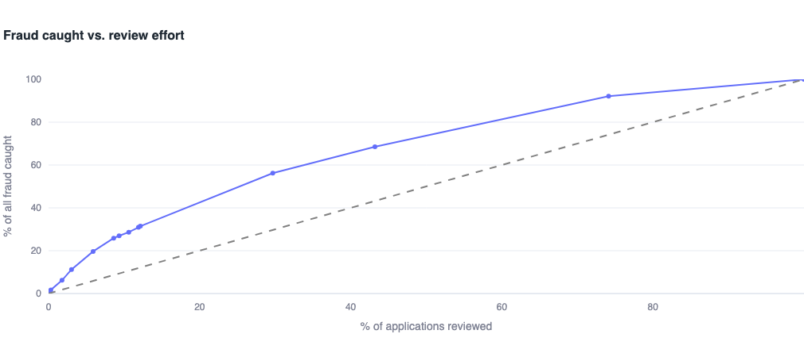
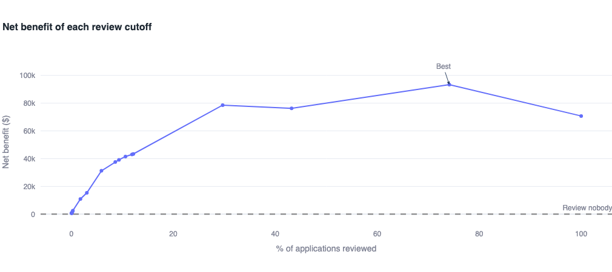

# FinTech Risk Operations Engine

A fraud-risk analytics project that scores device-financing applications, finds which red flags matter, and answers the business question: **which applications are worth the cost of a manual review?**

> Built by a former telecom fraud investigator. The data is **synthetic** (5,000 generated applications with planted fraud patterns), so the point is the method, not the numbers.


## What it does

- **Scores every application** with transparent, rule-based risk points and sorts it into High, Medium or Low.
- **Proves the score works:** High-tier applications are fraud about 10.7% of the time, versus 2.2% for Low.
- **Ranks red flags by lift**, meaning how many times riskier an application is when the flag is present.
- **Checks itself for false patterns:** credit score was deliberately left out of the fraud rule, and the dashboard shows error bars so random wobble isn't mistaken for a finding.
- **Turns risk into dollars.** With sliders for review cost and catch rate, it finds the review policy with the best net benefit (about +$93k at $25 per review, versus about +$27k at $60).




## Tech

Python · pandas · NumPy · DuckDB (SQL) · Streamlit · Plotly · pytest · Git/GitHub

## How it is built

| Folder | Purpose |
|---|---|
| `src/generate_data.py` | Creates the synthetic applications (seeded, so it's reproducible) |
| `src/risk_score.py` | SQL scoring rules and tiers, run with DuckDB |
| `src/scoring.py` | The same rules in Python, used by the tests as a cross-check |
| `src/metrics.py` | Tested calculations: lift, error bars, review net benefit |
| `app/dashboard.py` | The Streamlit dashboard |
| `tests/` | 19 automated tests |

## Run it yourself

```bash
git clone https://github.com/SaminRahman/fintech-risk-engine.git
cd fintech-risk-engine
python3 -m venv venv && source venv/bin/activate
pip install -r requirements.txt
python src/generate_data.py
python src/risk_score.py
streamlit run app/dashboard.py
```

## Run the tests

```bash
python -m pytest
```
The tests check the generated data, the scoring rules (including that the Python rules agree with the SQL) and the dashboard's calculations.

## A bug the tests now guard against

An early version of the data generator had `rng.choice(N) < 0.08` instead of `rng.random(N) < 0.08`, which silently switched the address-mismatch flag off for every row. Nothing crashed. I noticed because the overall fraud rate (2.64%) was lower than my hand calculation (about 3.3%). It is now a permanent regression test.

## Limitations

- The data is synthetic, so the planted patterns are *recovered*, not *discovered*.
- Dollar loss is the device price, with no recovery, shipping or collections costs.
- Some groups are small, so differences under about 1 percentage point are within normal wobble.


## Author
Samin Yasar Rahman, https://www.linkedin.com/in/saminrahman/
