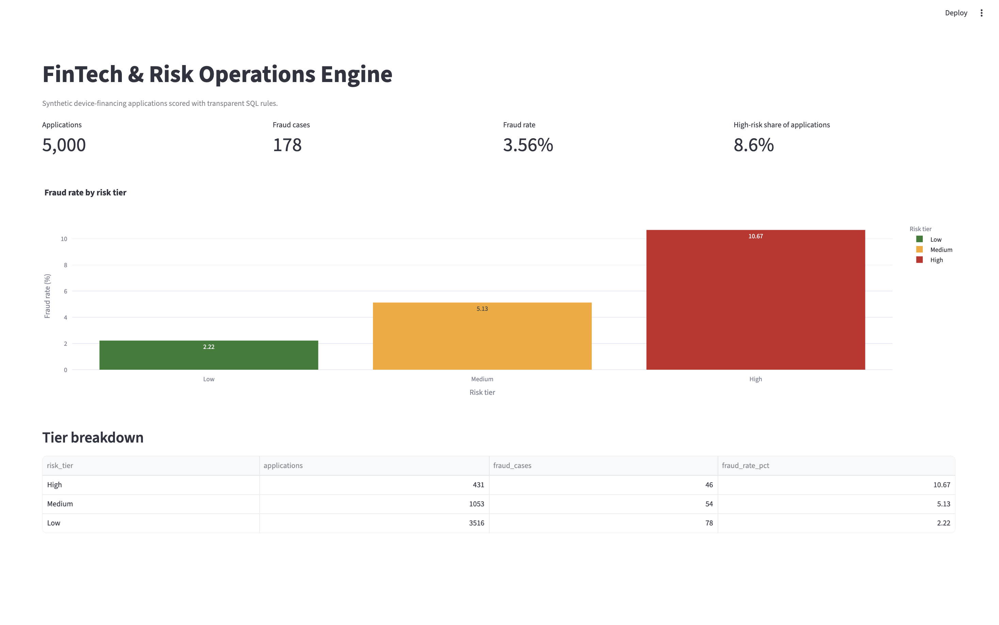

# FinTech & Risk Operations Engine

A fraud and credit-risk analytics dashboard for device-financing applications, built with Python, DuckDB SQL, and Streamlit.

## Why I built this
I spent 4 years at Rogers investigating device-financing fraud. This project turns that domain experience into a working analytics tool: it detects risky applications, quantifies fraud rates, and presents the findings in a live dashboard.

## Tech stack
- Python (pandas, numpy)
- DuckDB (SQL analytics)
- Streamlit + Plotly (dashboard)

## Documentation
See the full [Project Architecture](docs/architecture.md) for the problem statement, data dictionary, risk rules, results and validation checks.

## Roadmap
- [x] Synthetic data generator
- [x] SQL fraud analysis (by channel, device, account age)
- [x] Rule-based risk scoring
- [ ] Streamlit dashboard
- [ ] Deployed live demo

## Dashboard preview

## Status
In active development (started October 2026).

## Author
Samin Yasar Rahman, https://www.linkedin.com/in/saminrahman/
