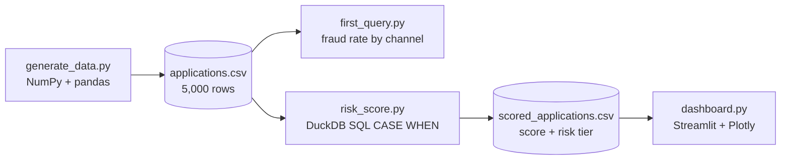
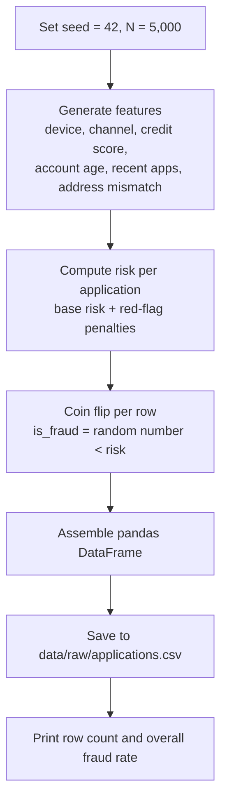
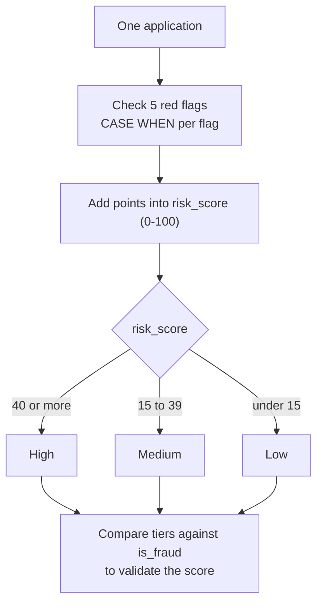
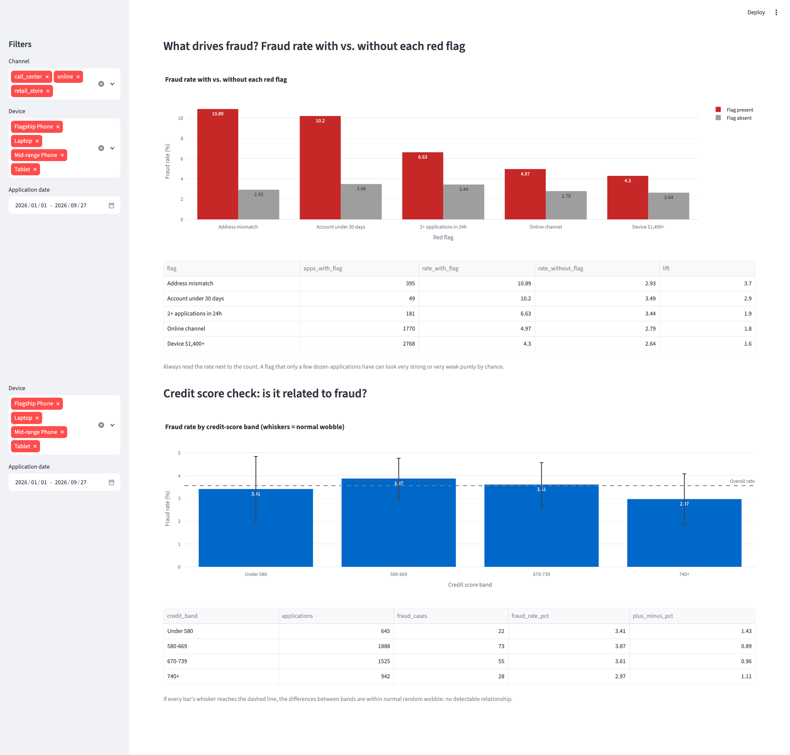
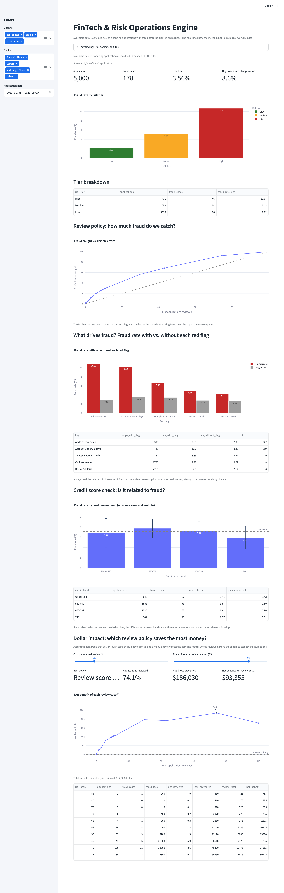

# FinTech & Risk Operations Engine: Project Architecture

**Repository:** https://github.com/SaminRahman/fintech-risk-engine
**Stack:** Python, NumPy, pandas, DuckDB (SQL), Streamlit, Plotly
**Live demo:** PASTE YOUR STREAMLIT LINK HERE (hosted free on Streamlit Community Cloud)
**Status:** Version 1 complete (started October 2026). Data pipeline, SQL risk scoring, an interactive dashboard (sidebar filters, review-policy curve, red-flag lift analysis, credit-score check and a dollar-impact analysis), 19 automated tests and a deployed live demo.
**Last updated:** October 23, 2026

---

## 1. Problem Statement

When a customer finances a phone, tablet or laptop, the lender ships an expensive device before the full price is paid. Fraudsters exploit this with stolen identities, fake accounts and rapid-fire applications. A single successful fraud case can cost the lender the full device price.

Risk teams need to answer three questions quickly:

1. **How much fraud is there?** (fraud rate)
2. **Where is it concentrated?** (channel, device, account age, behaviour)
3. **Which applications should be reviewed before shipping?** (risk scoring)

This project builds an end-to-end analytics pipeline that answers those questions: it generates realistic application data, scores risk with transparent SQL rules, validates the score against outcomes, and presents the results in an interactive dashboard.

**Domain context:** The risk signals were chosen from the author's four years of experience investigating device-financing fraud at a Canadian telecom provider.

---

## 2. Why Synthetic Data

Real customer data is private and cannot be published. Synthetic data lets the whole project be shared publicly, reproduced by anyone, and verified against known rules.

**Important caveat:** because the fraud patterns were written into the generator, the analysis *recovers* patterns that were planted rather than *discovering* unknown ones. The project demonstrates the pipeline, the analysis method and the validation habits, not new fraud findings. All results should be read as demonstrations on synthetic data.

---

## 3. System Architecture

### 3.1 High-level pipeline



### 3.2 Data generation logic



### 3.3 Risk scoring logic



### 3.4 Component responsibilities

| Component | Technology | Responsibility |
|---|---|---|
| `src/generate_data.py` | Python, NumPy, pandas | Creates 5,000 synthetic applications with embedded fraud patterns and saves a CSV |
| `data/raw/applications.csv` | CSV (git-ignored) | The raw dataset; regenerated on demand from the seed |
| `src/first_query.py` | Python, DuckDB SQL | Fraud rate by channel, run directly on the CSV |
| `src/risk_score.py` | Python, DuckDB SQL | Scores every application with `CASE WHEN` rules, assigns a tier, saves the result and validates tiers against fraud |
| `data/processed/scored_applications.csv` | CSV (tracked on purpose) | Raw data plus `risk_score` and `risk_tier` columns. It is the one data file committed to Git so the deployed app has data; it can be recreated from the seed |
| `src/scoring.py` | Python, pandas | The same scoring rules written in Python, used as an independent reference by the tests |
| `src/metrics.py` | Python | Small tested functions: `wobble_pct` (error bars), `lift`, `net_benefit_table` (review economics) |
| `app/dashboard.py` | Streamlit, Plotly, DuckDB | Interactive dashboard: sidebar filters, KPIs, fraud rate by tier, review-policy curve, fraud lift by red flag, credit-score check, dollar-impact calculator |
| `tests/` | pytest | 19 automated tests (data sanity, scoring rules, metric functions) |
| `.streamlit/config.toml` | Streamlit | Light theme so the live app and screenshots look the same everywhere |
| `requirements.txt` | pip | Pins library versions so the environment can be recreated and the app can be deployed |

### 3.5 Repository structure

```
fintech-risk-engine/
├── .streamlit/
│   └── config.toml           # Dashboard theme
├── app/
│   └── dashboard.py          # Streamlit dashboard
├── data/
│   ├── raw/                  # Generated CSV (git-ignored)
│   └── processed/            # Scored CSV (the one tracked data file)
├── docs/
│   ├── architecture.md       # This document
│   └── images/               # Dashboard screenshots
├── src/
│   ├── generate_data.py      # Synthetic data generator
│   ├── first_query.py        # First DuckDB SQL analysis
│   ├── risk_score.py         # SQL risk scoring and validation
│   ├── scoring.py            # Python reference scoring (used by tests)
│   └── metrics.py            # Tested dashboard calculations
├── tests/
│   ├── test_data.py          # Data sanity tests
│   ├── test_scoring.py       # Scoring rule tests, SQL vs Python check
│   └── test_metrics.py       # Metric function tests
├── .gitignore
├── pytest.ini
├── README.md
└── requirements.txt
```

---

## 4. Data Dictionary

Each row is one device-financing application. The first ten columns come from the generator; the last two are added by the scoring step.

| Column | Type | How it is generated | Meaning |
|---|---|---|---|
| `application_id` | text | `APP100000` upward | Unique application ID |
| `applied_at` | datetime | Random minute between Jan 1, 2026 and about late Sep 2026 (270 days) | When the application was submitted |
| `channel` | text | retail_store 45%, online 35%, call_center 20% | Where the customer applied |
| `device` | text | Flagship Phone 40%, Mid-range Phone 30%, Tablet 15%, Laptop 15% | Device being financed |
| `device_price` | integer | Flagship $1,400; Mid-range $700; Tablet $900; Laptop $1,600 | Price of the device |
| `credit_score` | integer | Normal distribution, mean 670, std 80, clipped to 300-850 | Applicant credit score |
| `account_age_days` | integer | Uniform whole numbers, 0 to 3,649 | Days since the customer account was opened |
| `apps_last_24h` | integer | Poisson, mean 0.3 | Applications by this customer in the past 24 hours |
| `address_mismatch` | boolean | True for about 8% of rows | Billing and shipping addresses differ |
| `is_fraud` | boolean | Per-row coin flip against that row's risk (section 5) | Ground-truth fraud label |
| `risk_score` | integer | Points from red flags (section 6) | Pre-outcome risk score, 0-100 |
| `risk_tier` | text | Thresholds on `risk_score` (section 6) | Low, Medium or High |

---

## 5. Fraud Generation Rules (the "ground truth")

These rules decide which synthetic applications become fraud. Each application starts with a **1% base fraud probability**, and each red flag adds to it:

| Red flag | Condition | Risk added | Rationale |
|---|---|---|---|
| Base risk | Always | +1.0% | Fraud exists in every segment |
| Online channel | `channel = 'online'` | +2.0% | No face-to-face identity check |
| High-value device | `device_price >= 1400` | +1.5% | Expensive devices are more profitable to resell |
| New account | `account_age_days < 30` | +3.0% | Fraudsters open fresh accounts |
| Burst of applications | `apps_last_24h >= 2` | +4.0% | Multiple applications in a day is a classic velocity signal |
| Address mismatch | `address_mismatch = True` | +8.0% | Shipping to a different address is the strongest single signal |

**Formula**

```
risk = 0.01
     + 0.02  * (channel == "online")
     + 0.015 * (device_price >= 1400)
     + 0.03  * (account_age_days < 30)
     + 0.04  * (apps_last_24h >= 2)
     + 0.08  * (address_mismatch)
```

A condition that is true counts as 1 and false counts as 0, so each flag adds its penalty only when it applies. The maximum possible risk (every flag on) is **19.5%**.

**Fraud label:** `is_fraud = (random number between 0 and 1) < risk`. An application with 7.5% risk has a 7.5% chance of being labelled fraud.

**Worked example:** an online order for a $1,400 phone on a 10-day-old account with no other flags:
0.01 + 0.02 + 0.015 + 0.03 = **0.075 (7.5%)**.

**Design note:** `credit_score` is generated as a realistic feature but is deliberately *not* part of the fraud formula. Section 8.6 shows it has no detectable relationship with fraud, which is a useful test that the analysis does not invent patterns.

---

## 6. Risk Scoring Model (what an analyst would build)

The score is calculated **before** the outcome is known, so a reviewer could examine the riskiest applications first. Points are an analyst's judgment, scaled to 0-100. They are not copied from the generator's weights, because in real life the true weights are unknown and the score must be validated against outcomes.

| Red flag | Condition | Points |
|---|---|---|
| Address mismatch | `address_mismatch = True` | 40 |
| Burst of applications | `apps_last_24h >= 2` | 25 |
| New account | `account_age_days < 30` | 20 |
| Online channel | `channel = 'online'` | 10 |
| High-value device | `device_price >= 1400` | 5 |
| **Maximum** | | **100** |

| Tier | Score |
|---|---|
| High | 40 or more |
| Medium | 15 to 39 |
| Low | under 15 |

### The SQL

```sql
WITH scored AS (
    SELECT *,
           (CASE WHEN channel = 'online'      THEN 10 ELSE 0 END
          + CASE WHEN device_price >= 1400    THEN 5  ELSE 0 END
          + CASE WHEN account_age_days < 30   THEN 20 ELSE 0 END
          + CASE WHEN apps_last_24h >= 2      THEN 25 ELSE 0 END
          + CASE WHEN address_mismatch        THEN 40 ELSE 0 END
           ) AS risk_score
    FROM 'data/raw/applications.csv'
)
SELECT *,
       CASE WHEN risk_score >= 40 THEN 'High'
            WHEN risk_score >= 15 THEN 'Medium'
            ELSE 'Low'
       END AS risk_tier
FROM scored
```

| SQL piece | What it does |
|---|---|
| `CASE WHEN ... THEN ... ELSE ... END` | SQL's if/else; gives points when a flag applies |
| `WITH scored AS (...)` | A named first step (a CTE) that the second step builds on |
| Tier `CASE` block | Checks top to bottom and stops at the first match, so High is listed first |
| `COPY (...) TO 'file.csv'` | Writes the scored result to `data/processed/` |

---

## 7. Expected Fraud Rate (Hand Calculation)

The expected overall fraud rate is the sum of (how often each flag occurs) x (risk it adds):

| Component | Frequency | Risk added | Contribution |
|---|---|---|---|
| Base risk | 100% | 1.0% | 1.000% |
| Online channel | 35% | 2.0% | 0.700% |
| Device >= $1,400 (flagship 40% + laptop 15%) | 55% | 1.5% | 0.825% |
| Account under 30 days (30 of 3,650 days) | about 0.8% | 3.0% | 0.025% |
| 2+ applications in 24h (Poisson, mean 0.3) | about 3.7% | 4.0% | 0.148% |
| Address mismatch | 8% | 8.0% | 0.640% |
| **Expected overall rate** | | | **about 3.34%** |

With 5,000 rows, normal random variation is about +/-0.25 percentage points, so any run between roughly 2.8% and 3.9% is plausible.

---

## 8. Results

**Key findings (synthetic data):**

- The overall fraud rate is 3.56%, and online applications are about twice as risky as call-center applications.
- The rule-based score ranks risk correctly: High-tier applications are 4.8x as likely to be fraud as Low-tier ones.
- Reviewing the riskiest 30% of applications catches 56% of fraud.
- Address mismatch is the strongest single red flag (3.7x lift). Credit score, which the generator ignores, shows no detectable relationship with fraud.
- Whether a review is worth it depends on its cost. With reviews that catch 90% of fraud, the best policy at $25 per review examines about 74% of applications and nets about $93,000; at $60 per review the best policy examines only about 30% and nets about $27,000.

### 8.1 Overall

5,000 applications, 178 fraud cases, **3.56% fraud rate** (within normal variation of the 3.34% expected).

### 8.2 Fraud rate by channel

| Channel | Applications | Fraud cases | Fraud rate |
|---|---|---|---|
| online | 1,770 | 88 | 4.97% |
| retail_store | 2,260 | 68 | 3.01% |
| call_center | 970 | 22 | 2.27% |
| **Total** | **5,000** | **178** | **3.56%** |

Online applications are about twice as likely to be fraudulent as call-center applications, consistent with the +2% online rule.

### 8.3 Fraud rate by risk tier (does the score work?)

| Risk tier | Applications | Share of applications | Fraud cases | Fraud rate |
|---|---|---|---|---|
| High | 431 | 8.6% | 46 | 10.67% |
| Medium | 1,053 | 21.1% | 54 | 5.13% |
| Low | 3,516 | 70.3% | 78 | 2.22% |
| **Total** | **5,000** | **100%** | **178** | **3.56%** |

The rate climbs from Low to Medium to High, which is what a working score should do. A High-tier application is about **4.8x** as likely to be fraud as a Low-tier one and about **3x** the overall average.

### 8.4 Review-policy trade-off

If a fraud team manually reviews only the highest-risk applications:

| Review policy | Applications reviewed | Fraud caught | Share of all fraud caught | Fraud rate among reviewed |
|---|---|---|---|---|
| High only | 431 (8.6%) | 46 | 25.8% | 10.67% |
| High + Medium | 1,484 (29.7%) | 100 | 56.2% | 6.74% |
| Everyone | 5,000 (100%) | 178 | 100% | 3.56% |

Reviewing High + Medium covers 30% of applications but catches 56% of fraud, so each review is about 1.9x as productive as a random one. Reviewing High only is 3x as productive but misses about three quarters of the fraud. This is the core trade-off in fraud operations: **review effort against fraud caught**. About 9 in 10 High-tier applications are still genuine customers (false positives), which teams accept because a missed fraud costs the device price while an unnecessary review costs minutes.

### 8.5 Fraud rate by red flag (lift)

For each flag, the fraud rate among applications that have it versus those that do not. **Lift** is the ratio of the two.

| Red flag | Applications with flag | Fraud rate with flag | Fraud rate without | Lift |
|---|---|---|---|---|
| Address mismatch | 395 | 10.89% | 2.93% | 3.7x |
| Account under 30 days | 49 | 10.20% | 3.49% | 2.9x |
| 2+ applications in 24h | 181 | 6.63% | 3.44% | 1.9x |
| Online channel | 1,770 | 4.97% | 2.79% | 1.8x |
| Device $1,400+ | 2,768 | 4.30% | 2.64% | 1.6x |

Address mismatch is clearly the strongest signal, consistent with its +8% rule. Observed rates sit close to the 10.7%, 7.2%, 4.6% and 4.0% that the generator rules imply for the address, burst, online and device flags.

**Sample-size caution:** only 49 applications have the new-account flag, and 5 of them were fraud, so its rate (10.2%) is far noisier than the others. Its normal random wobble is about +/-8.6 percentage points, which comfortably includes the roughly 6.3% the rules imply. Its apparent rank (second) should not be trusted. A rate must always be read next to its count.

### 8.6 Credit-score check (does the analysis invent patterns?)

Credit score is generated realistically but is not used in the fraud rules, so no relationship should appear.

| Credit score band | Applications | Fraud cases | Fraud rate | Normal wobble (+/-) |
|---|---|---|---|---|
| Under 580 | 645 | 22 | 3.41% | 1.43 |
| 580-669 | 1,888 | 73 | 3.87% | 0.89 |
| 670-739 | 1,525 | 55 | 3.61% | 0.96 |
| 740+ | 942 | 28 | 2.97% | 1.11 |

The overall rate is 3.56%. Every band's error range includes it, so the differences are consistent with random noise: **no detectable relationship**. That is weaker than "proven unrelated"; a different random seed would reorder the bars. The wobble is about two standard errors, calculated as 200 x sqrt(p x (1 - p) / n) in percentage points.

### 8.7 Dollar impact (which review policy pays?)

Each fraud case is assumed to cost the lender the device price, with no recovery. The total fraud loss in the dataset is **$217,500** across 178 cases (about $1,222 per case).

A policy means "review every application with a risk score at or above a cutoff". For each cutoff the dashboard calculates:

- **Loss prevented** = catch rate x fraud dollars among reviewed applications
- **Review cost** = cost per review x applications reviewed
- **Net benefit** = loss prevented - review cost

The best cutoff is the one with the highest net benefit. Intuitively, a group of applications is worth reviewing while its average fraud dollars per application x catch rate is greater than the cost of one review.

Results with reviews that catch 90% of fraud:

| Cost per review | Best policy | Applications reviewed | Loss prevented | Review spend | Net benefit |
|---|---|---|---|---|---|
| $25 | Score 5 or more | 3,707 (74.1%) | $186,030 | $92,675 | **$93,355** |
| $60 | Score 15 or more | 1,484 (29.7%) | $115,650 | $89,040 | **$26,610** |

Reviewing everyone is not the best policy at either price: it nets $70,750 at $25 per review and loses $104,250 at $60 per review. The $60 policy is the same High + Medium group from section 8.4. When reviews get 2.4 times more expensive, the best policy reviews less than half as many applications and the net benefit falls by about 70%. The right review cutoff is a business decision that depends on review cost and review quality, not a property of the score alone.

---

## 9. Dashboard

**Version 1 (done):** four KPI tiles (applications, fraud cases, fraud rate, high-risk share), a bar chart of fraud rate by risk tier, and a tier breakdown table. All numbers come from live DuckDB SQL over the scored CSV.


**Version 2 (done):** sidebar filters for channel, device and application date; every KPI and chart recalculates on the filtered rows.

**Review-policy curve (done):** plots the cumulative share of fraud caught against the cumulative share of applications reviewed, riskiest first, with a dashed diagonal showing random review. Its points reproduce the table in section 8.4 (about 9% reviewed catches about 26% of fraud; about 30% reviewed catches about 56%), and it stays above the random-review diagonal throughout.

**Fraud drivers (done):** grouped bars compare the fraud rate with and without each red flag, with a table of counts and lift (section 8.5).

**Credit-score check (done):** fraud rate by credit-score band with error bars (about two standard errors) and a dashed overall-rate line (section 8.6).



**Dollar impact (done):** two sliders (cost per manual review, share of fraud a review catches) drive a net-benefit curve over review cutoffs. The dashboard reports the best cutoff, the share of applications reviewed, the loss prevented and the net benefit (section 8.7). If no policy has a positive net benefit, it says to review nobody.

**Code clean-up (done):** the lift, error-bar and net-benefit calculations moved out of the dashboard into `src/metrics.py`, each with tests. The refactor was accepted only after every number on screen matched its value from before the change.

**Polish and release (done):** light theme, a synthetic-data caption, a collapsible key-findings box, consistent chart styling, and deployment to Streamlit Community Cloud.



Run it with:

```bash
streamlit run app/dashboard.py
```

---

## 10. Validation and Quality Checks

| Check | Method | Result |
|---|---|---|
| Channel counts tie out | Application counts sum to 5,000 | Passed (1,770 + 2,260 + 970) |
| Channel fraud ties out | Fraud cases sum to the overall total | Passed (88 + 68 + 22 = 178) |
| Tier counts tie out | Tier applications sum to 5,000 | Passed (431 + 1,053 + 3,516) |
| Tier fraud ties out | Tier fraud cases sum to the overall total | Passed (46 + 54 + 78 = 178) |
| Overall rate matches hand calculation | Compare to the 3.34% expectation | Passed (3.56%, within normal variation) |
| Binary flag is populated correctly | `value_counts()` on `address_mismatch` | Passed (395 True, 4,605 False, about 8%) |
| Score ranks risk correctly | Fraud rate rises Low < Medium < High | Passed (2.22% < 5.13% < 10.67%) |
| Dashboard matches the terminal | KPI tiles equal the script output | Passed (5,000 / 178 / 3.56% / 8.6%) |
| Review-policy curve matches the table | Compare curve points to section 8.4 | Passed (about 9% reviewed / 26% caught; about 30% / 56%) |
| Red-flag counts tie out | Flag counts equal totals known from earlier checks | Passed (address mismatch 395 matches `value_counts()`; online 1,770 matches the channel table) |
| Red-flag rates match rules-based expectation | Compare observed rates to rates implied by the generator rules | Passed, except the new-account flag (49 applications), which is explained by sampling noise |
| Credit score shows no pattern | Every band's error range includes the overall rate | Passed (consistent with the generator ignoring credit score) |
| Reproducibility | Fixed seed of 42 | Same data on every run |
| Dollar-impact numbers tie out | Loss prevented minus review spend equals net benefit; high + medium reviews equal the 1,484 in section 8.4 | Passed ($186,030 - $92,675 = $93,355; $115,650 - $89,040 = $26,610) |
| Refactor changed no results | Compare lift, error bars and dollar-impact values before and after moving code into `src/metrics.py` | Passed (all values identical) |
| SQL and Python scoring agree | A test compares `src/scoring.py` with the SQL output on all 5,000 rows | Passed |
| Automated tests | `python -m pytest` | 19 passed |

### Automated tests

Run with `python -m pytest` (configured by `pytest.ini`).

| File | Tests | What it protects |
|---|---|---|
| `tests/test_data.py` | 6 | Row count and unique IDs, no missing values, expected categories, credit scores within 300-850, address mismatch near 8% (a regression test for the bug below), plausible overall fraud rate |
| `tests/test_scoring.py` | 6 | Clean application scores 0, each flag adds its points, boundary values (29 vs 30 days, $1,399 vs $1,400, 14 vs 15 and 39 vs 40 points), a worked example, and agreement between the Python rules and the SQL output |
| `tests/test_metrics.py` | 7 | Error-bar formula against a hand calculation and the dashboard's values, lift with a zero denominator, net benefit on a small table worked out by hand, and that inputs are not modified |

Two lessons from building them: broad checks miss subtle bugs (the buggy overall fraud rate of 2.64% still passed a broad 2.5% to 4.5% range, so a specific address-mismatch check was needed), and comparing two independent implementations (SQL and Python) catches changes made in only one place.

### Bug log

| Bug | Symptom | Root cause | Fix |
|---|---|---|---|
| `address_mismatch` always False | Overall fraud rate 2.64%, below the expected 3.34% | `rng.choice(N) < 0.08` returns **one** random number and one True/False, which pandas copied to all rows. Should be `rng.random(N) < 0.08`, which gives 5,000 independent values | Corrected the line and verified with `value_counts()` |
| Missing comma in DataFrame definition | `SyntaxError: Perhaps you forgot a comma?` | A dictionary entry was missing its trailing comma; Python reported the error on the following line | Added the comma |
| Git still ignored the scored CSV needed for deployment | `git check-ignore` still pointed at the old `data/processed/` rule and `data/` showed as untracked | The old rule ignored the whole folder, so an exception inside it cannot work; the edit had also replaced the wrong line | Rewrote `.gitignore` with `data/processed/*` plus `!data/processed/scored_applications.csv` and confirmed with `git status -uall` |

**Regression test:** the first bug is now guarded by `test_address_mismatch_is_about_8_percent`, which fails if the flag is ever switched off again.

**How the first bug was caught:** the hand calculation predicted about 3.3%, but the run gave 2.64%, almost exactly the 2.70% expected with the address rule switched off. A gap that large and that specific pointed to one missing rule, and a column check confirmed it. The lesson: a bug that raises no error can only be caught by checking outputs against expectations.

---

## 11. Known Limitations

- Data is synthetic, and fraud patterns are planted rather than observed.
- The score uses the same red flags the generator used, so part of its performance is built in. The value shown is the method: build a score, then validate it against outcomes.
- Score points and tier cutoffs were chosen by judgment and evaluated on the same data; there is no held-out test set.
- Fraud rules are additive and independent; real fraud involves interactions between signals (for example, a new account that is also online).
- Only six risk signals are modelled; real systems use many more (device fingerprints, IP address, velocity across accounts).
- Scoring is rule-based, with no machine learning model.
- Rates for flags with few applications (for example the 49 new-account applications) are noisy; firm conclusions about them would need larger samples.
- Dollar loss is simply the device price. It ignores recovery of devices, shipping, collections costs and the cost of turning away genuine customers.
- Review cost and catch rate are assumptions chosen with sliders, not measured values; real values would come from operations data.
- The free hosting plan puts the live app to sleep when nobody visits, so the first load after a quiet period can take a few seconds.

---

## 12. Roadmap

| Phase | Deliverable | Status |
|---|---|---|
| Setup | Git, GitHub, Python environment, dependencies | Done |
| Data | Synthetic data generator with embedded fraud patterns | Done |
| Analysis | First DuckDB query: fraud rate by channel | Done |
| Scoring | Rule-based risk score and tiers in SQL (`CASE WHEN`), validated against fraud | Done |
| Dashboard | Streamlit v1: KPIs, fraud rate by tier, tier table | Done |
| Documentation | Architecture document in repo and README preview screenshot | Done |
| Dashboard | Sidebar filters (channel, device, date) | Done |
| Dashboard | Review-policy curve (review top X%, fraud caught) | Done |
| Analysis | Fraud rate and lift by individual red flag; credit-score check | Done |
| Impact | Dollar impact: net savings at different review cutoffs, with adjustable review cost and catch rate | Done |
| Quality | Code clean-up into tested functions; 19 automated tests including a SQL-vs-Python consistency check | Done |
| Release | Dashboard polish, README rewrite, deployed live demo | Done |
| Next project | Michigan Real Estate Yield Analyzer (Excel pro-forma and Streamlit app) | Planned |

---

## 13. How to Run

```bash
# 1. Clone and enter the project
git clone https://github.com/SaminRahman/fintech-risk-engine.git
cd fintech-risk-engine

# 2. Create and activate a virtual environment
python3 -m venv venv
source venv/bin/activate

# 3. Install dependencies
pip install -r requirements.txt

# 4. Generate the data
python src/generate_data.py

# 5. Score the applications and validate the tiers
python src/risk_score.py

# 6. Launch the dashboard
streamlit run app/dashboard.py

# 7. Run the automated tests
python -m pytest
```

---

## 14. Skills Demonstrated

- **Python:** NumPy random generation, pandas DataFrames, file handling
- **SQL (DuckDB):** aggregation, grouping, type casting, `CASE WHEN` scoring, CTEs, querying CSVs directly
- **Analytics:** fraud-rate metrics, risk tiers, lift analysis, review-policy trade-offs, hand-estimating expected results, tying out totals
- **Statistical thinking:** sample-size caution, error bars (about two standard errors), testing that an analysis does not invent patterns
- **Business analysis:** turning a risk score into a cost-benefit decision (review cost, catch rate, net benefit)
- **Data validation:** debugging a silent data bug using expectation checks
- **Testing:** pytest unit, boundary and regression tests; checking two independent implementations (SQL and Python) against each other
- **Dashboarding:** Streamlit and Plotly with live SQL
- **Engineering practice:** Git and GitHub workflow, refactoring without changing results, reproducible environment, deployment to Streamlit Community Cloud, documentation
- **Domain knowledge:** fraud signals drawn from real device-financing investigations
