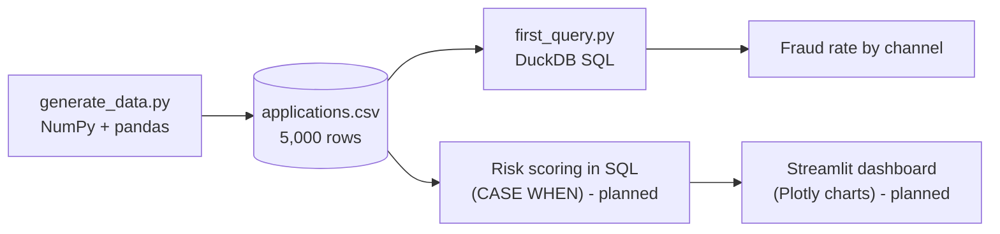
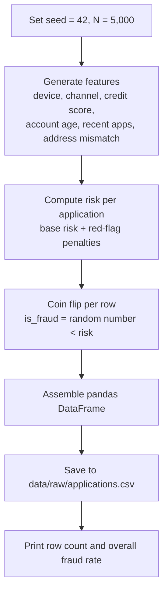

# FinTech & Risk Operations Engine: Project Architecture

**Repository:** https://github.com/SaminRahman/fintech-risk-engine
**Stack:** Python, NumPy, pandas, DuckDB (SQL), Streamlit, Plotly
**Status:** In development (started October 2026). Data pipeline and first SQL analysis complete; risk scoring and dashboard in progress.

---

## 1. Problem Statement

When a customer finances a phone, tablet or laptop, the lender ships an expensive device before the full price is paid. Fraudsters exploit this with stolen identities, fake accounts and rapid-fire applications. A single successful fraud case can cost the lender the full device price.

Risk teams need to answer three questions quickly:

1. **How much fraud is there?** (fraud rate)
2. **Where is it concentrated?** (channel, device, account age, behaviour)
3. **Which applications should be reviewed before shipping?** (risk scoring)

This project builds an end-to-end analytics pipeline that answers those questions: it generates realistic application data, analyses it with SQL, scores risk with transparent rules, and presents the results in an interactive dashboard.

**Domain context:** The risk signals were chosen from the author's four years of experience investigating device-financing fraud at a Canadian telecom provider.

---

## 2. Why Synthetic Data

Real customer data is private and cannot be published. Synthetic data lets the whole project be shared publicly, reproduced by anyone, and verified against known rules.

**Important caveat:** because the fraud patterns were written into the generator, the SQL analysis *recovers* patterns that were planted rather than *discovering* unknown ones. The project demonstrates the pipeline, the analysis method and the validation habits, not new fraud findings. All results should be read as demonstrations on synthetic data.

---

## 3. System Architecture

### 3.1 High-level pipeline



### 3.2 Data generation logic



### 3.3 Component responsibilities

| Component | Technology | Responsibility |
|---|---|---|
| `src/generate_data.py` | Python, NumPy, pandas | Creates 5,000 synthetic applications with embedded fraud patterns and saves a CSV |
| `data/raw/applications.csv` | CSV (git-ignored) | The dataset; regenerated on demand from the seed |
| `src/first_query.py` | Python, DuckDB SQL | Runs SQL directly on the CSV to compute fraud rate by channel |
| Risk scoring layer | DuckDB SQL (`CASE WHEN`) | *Planned:* flags each application by risk tier |
| `app/` dashboard | Streamlit, Plotly | *Planned:* interactive charts and filters |
| `requirements.txt` | pip | Pins library versions so the environment can be recreated |

### 3.4 Repository structure

```
fintech-risk-engine/
├── app/                  # Streamlit dashboard (planned)
├── data/raw/             # Generated CSV (git-ignored, recreate with script)
├── src/
│   ├── generate_data.py  # Synthetic data generator
│   └── first_query.py    # First DuckDB SQL analysis
├── .gitignore
├── README.md
└── requirements.txt
```

---

## 4. Data Dictionary

Each row is one device-financing application.

| Column | Type | How it is generated | Meaning |
|---|---|---|---|
| `application_id` | text | `APP100000` upward | Unique application ID |
| `applied_at` | datetime | Random minute between Jan 1, 2026 and about late Sep 2026 (270 days) | When the application was submitted |
| `channel` | text | retail_store 45%, online 35%, call_center 20% | Where the customer applied |
| `device` | text | Flagship Phone 40%, Mid-range Phone 30%, Tablet 15%, Laptop 15% | Device being financed |
| `device_price` | integer | Flagship $1,400; Mid-range $700; Tablet $900; Laptop $1,600 | Price of the device |
| `credit_score` | integer | Normal distribution, mean 670, std 80, clipped to 300-850 | Applicant credit score |
| `account_age_days` | integer | Uniform whole numbers, 0 to 3,649 | Days since the customer account was opened |
| `apps_last_24h` | integer | Poisson, mean 0.3 | Applications by this customer in the past 24 hours |
| `address_mismatch` | boolean | True for about 8% of rows | Billing and shipping addresses differ |
| `is_fraud` | boolean | Per-row coin flip against that row's risk (section 5) | Ground-truth fraud label |

---

## 5. Fraud Risk Rules

Each application starts with a **1% base fraud probability**. Each red flag adds to it:

| Red flag | Condition | Risk added | Rationale |
|---|---|---|---|
| Base risk | Always | +1.0% | Fraud exists in every segment |
| Online channel | `channel = 'online'` | +2.0% | No face-to-face identity check |
| High-value device | `device_price >= 1400` | +1.5% | Expensive devices are more profitable to resell |
| New account | `account_age_days < 30` | +3.0% | Fraudsters open fresh accounts |
| Burst of applications | `apps_last_24h >= 2` | +4.0% | Multiple applications in a day is a classic velocity signal |
| Address mismatch | `address_mismatch = True` | +8.0% | Shipping to a different address is the strongest single signal |

**Formula**

```
risk = 0.01
     + 0.02  * (channel == "online")
     + 0.015 * (device_price >= 1400)
     + 0.03  * (account_age_days < 30)
     + 0.04  * (apps_last_24h >= 2)
     + 0.08  * (address_mismatch)
```

A condition that is true counts as 1 and false counts as 0, so each flag adds its penalty only when it applies. The maximum possible risk (every flag on) is **19.5%**.

**Fraud label:** `is_fraud = (random number between 0 and 1) < risk`. An application with 7.5% risk has a 7.5% chance of being labelled fraud.

**Worked example:** an online order for a $1,400 phone on a 10-day-old account with no other flags:
0.01 + 0.02 + 0.015 + 0.03 = **0.075 (7.5%)**.

**Design note:** `credit_score` is generated as a realistic feature but is deliberately *not* part of the fraud formula. A later analysis should show it has no relationship with fraud, which is a useful test that the analysis does not invent patterns.

---

## 6. Expected Fraud Rate (Hand Calculation)

The expected overall fraud rate is the sum of (how often each flag occurs) x (risk it adds):

| Component | Frequency | Risk added | Contribution |
|---|---|---|---|
| Base risk | 100% | 1.0% | 1.000% |
| Online channel | 35% | 2.0% | 0.700% |
| Device >= $1,400 (flagship 40% + laptop 15%) | 55% | 1.5% | 0.825% |
| Account under 30 days (30 of 3,650 days) | about 0.8% | 3.0% | 0.025% |
| 2+ applications in 24h (Poisson, mean 0.3) | about 3.7% | 4.0% | 0.148% |
| Address mismatch | 8% | 8.0% | 0.640% |
| **Expected overall rate** | | | **about 3.34%** |

With 5,000 rows, normal random variation is about +/-0.25 percentage points, so any run between roughly 2.8% and 3.9% is plausible.

---

## 7. Results So Far

**Overall:** 5,000 applications, 178 fraud cases, **3.56% fraud rate** (within normal variation of the 3.34% expected).

**Fraud rate by channel** (`src/first_query.py`):

| Channel | Applications | Fraud cases | Fraud rate |
|---|---|---|---|
| online | 1,770 | 88 | 4.97% |
| retail_store | 2,260 | 68 | 3.01% |
| call_center | 970 | 22 | 2.27% |
| **Total** | **5,000** | **178** | **3.56%** |

**Finding:** online applications are about twice as likely to be fraudulent as call-center applications (4.97% vs 2.27%), consistent with the +2% online risk rule.

### The SQL behind it

```sql
SELECT channel,
       COUNT(*)                              AS applications,
       SUM(is_fraud::INT)                    AS fraud_cases,
       ROUND(100.0 * AVG(is_fraud::INT), 2)  AS fraud_rate_pct
FROM 'data/raw/applications.csv'
GROUP BY channel
ORDER BY fraud_rate_pct DESC
```

| SQL piece | What it does |
|---|---|
| `FROM 'file.csv'` | DuckDB reads the CSV directly as a table, with no database server |
| `GROUP BY channel` | Sorts rows into one pile per channel |
| `COUNT(*)` | Rows in each pile |
| `is_fraud::INT` | Converts True/False to 1/0 |
| `SUM(...)` | Adds the 1s to count fraud cases |
| `AVG(...)` | Averages 1s and 0s to give the fraud share |
| `ORDER BY ... DESC` | Riskiest channel first |

---

## 8. Validation and Quality Checks

| Check | Method | Result |
|---|---|---|
| Row totals tie out | Channel application counts sum to 5,000 | Passed (1,770 + 2,260 + 970) |
| Fraud counts tie out | Channel fraud cases sum to overall total | Passed (88 + 68 + 22 = 178) |
| Overall rate matches hand calculation | Compare to the 3.34% expectation | Passed (3.56%, within normal variation) |
| Binary flag is populated correctly | `value_counts()` on `address_mismatch` | Passed (395 True, 4,605 False, about 8%) |
| Reproducibility | Fixed seed of 42 | Same data on every run |

### Bug log

| Bug | Symptom | Root cause | Fix |
|---|---|---|---|
| `address_mismatch` always False | Overall fraud rate 2.64%, below the expected 3.34% | `rng.choice(N) < 0.08` returns **one** random number and one True/False, which pandas copied to all rows. Should be `rng.random(N) < 0.08`, which gives 5,000 independent values | Corrected the line and verified with `value_counts()` |

**How it was caught:** the hand calculation predicted about 3.3%, but the run gave 2.64%, almost exactly the 2.70% expected with the address rule switched off. A gap that large and that specific pointed to one missing rule, and a column check confirmed it. The lesson: a bug that raises no error can only be caught by checking outputs against expectations.

---

## 9. Known Limitations

- Data is synthetic, and fraud patterns are planted rather than observed.
- Fraud rules are additive and independent; real fraud involves interactions between signals (for example, a new account that is also online).
- Only six risk signals are modelled; real systems use many more (device fingerprints, IP address, velocity across accounts).
- Risk scoring is rule-based, with no machine learning model.
- No fraud-loss dollar amounts yet; the analysis counts cases rather than money.

---

## 10. Roadmap

| Phase | Deliverable | Status |
|---|---|---|
| Setup | Git, GitHub, Python environment, dependencies | Done |
| Data | Synthetic data generator with embedded fraud patterns | Done |
| Analysis | First DuckDB query: fraud rate by channel | Done |
| Analysis | Fraud rate by device, account age, address mismatch, credit score band | Next |
| Scoring | Rule-based risk score and risk tiers in SQL (`CASE WHEN`) | Planned |
| Dashboard | Streamlit app with KPIs, charts and filters | Planned |
| Impact | Estimated fraud loss prevented at different review thresholds | Planned |
| Release | Deployed live demo and polished README with screenshots | Planned |

---

## 11. How to Run

```bash
# 1. Clone and enter the project
git clone https://github.com/SaminRahman/fintech-risk-engine.git
cd fintech-risk-engine

# 2. Create and activate a virtual environment
python3 -m venv venv
source venv/bin/activate

# 3. Install dependencies
pip install -r requirements.txt

# 4. Generate the data
python src/generate_data.py

# 5. Run the first analysis
python src/first_query.py
```

---

## 12. Skills Demonstrated

- **Python:** NumPy random generation, pandas DataFrames, file handling
- **SQL (DuckDB):** aggregation, grouping, type casting, querying CSVs directly
- **Analytics:** fraud-rate metrics, hand-estimating expected results, tying out totals
- **Data validation:** debugging a silent data bug using expectation checks
- **Engineering practice:** Git and GitHub workflow, reproducible environment, documentation
- **Domain knowledge:** fraud signals drawn from real device-financing investigations
